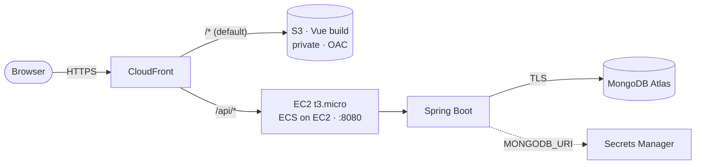
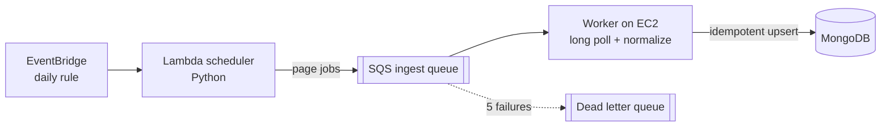

# ClearSpend

ClearSpend is a public finance transparency tool with explainable anomaly detection. It pulls public spending data from several government sources through an asynchronous pipeline, normalizes it into MongoDB, flags unusual spending with transparent statistical rules, and serves a search dashboard. The whole system runs on AWS and ships through a GitHub Actions pipeline.

**Live demo:** https://d2bkm3h6exrhk5.cloudfront.net

**Stack:** Java 21, Spring Boot 4, MongoDB Atlas, Vue 3 (Vite), AWS (ECS on EC2, ECR, S3, CloudFront, SQS, Lambda, EventBridge, Secrets Manager), and GitHub Actions with OIDC.

## What it does

ClearSpend ingests award and payment data from USAspending.gov and the city of Mesa, Arizona (Socrata), two sources with different schemas, through one pluggable connector interface. Every record is normalized into a canonical transaction and upserted on its natural key `(source, externalId)`, so replays and retries never create duplicates. An anomaly engine then runs two explainable rules and writes human readable flags. The first catches a payment far above its agency's typical spend, and the second catches a single recipient taking an outsized share of an agency's budget. The Vue dashboard lets you search and page through transactions by agency, recipient, and minimum amount, and shows the flags with their severity and a plain language explanation.

## Architecture

A single CloudFront distribution fronts the whole app. The default path serves the Vue build from a private S3 bucket, and `/api/*` is routed to the Spring Boot backend running on EC2. Because both tiers share one origin there is no CORS and no mixed content, and HTTPS is free through the `*.cloudfront.net` certificate with no custom domain to buy.



Ingestion is a decoupled producer and consumer. A daily EventBridge rule triggers a small Python Lambda that enqueues one page job per page onto an SQS queue. A worker running on the EC2 task long polls the queue, fetches and normalizes that page, and upserts it into MongoDB. A message that fails five times lands in a dead letter queue for inspection rather than being lost.



## Engineering highlights

The ingestion path is effectively exactly once. SQS delivers at least once, so correctness comes from the idempotent upsert on a unique `(source, externalId)` index. I verified this by killing the worker in the middle of a batch. The in flight messages reappeared after the visibility timeout, were reprocessed, and the document count converged with no loss and no duplicates.

The anomaly engine is fully explainable. Both rules run as MongoDB aggregations, the application applies the thresholds, and each flag stores a sentence a person can read. There is no model and there are no training labels, so every flag is auditable.

Deployment is secretless. GitHub Actions authenticates to AWS through an OIDC identity provider and assumes a scoped IAM role, so no long lived AWS keys live in the repository. Backend images are tagged with the git commit SHA, which keeps the running revision traceable and turns a rollback into a single task definition change. The database connection string lives in Secrets Manager and is injected into the container by the ECS execution role, so the password never sits in the task definition or the image.

## REST API

All endpoints live under `/api` because the backend sets `server.servlet.context-path=/api`.

| Method | Path | Purpose |
|---|---|---|
| `GET` | `/transactions?page&size&sort` | Paginated list |
| `GET` | `/transactions/search?agency&recipient&minAmount&page&size&sort` | Dynamic filtered search |
| `GET` | `/flags` | Latest anomaly flags |
| `POST` | `/internal/ingest/{source}?pages&limit` | Enqueue ingest page jobs |
| `GET` | `/internal/ingest/runs` | Ingestion run history |
| `POST` | `/internal/anomaly/run` | Run the anomaly rules |
| `GET` | `/actuator/health` | Health, including Mongo |

## Run locally

You need Java 21 and Docker.

```bash
docker compose up -d          # MongoDB on :27017
./mvnw spring-boot:run        # API on :8080 (JAVA_HOME must point to a Java 21 JDK)
curl http://localhost:8080/api/actuator/health
```

The Vue frontend lives in `frontend/`.

```bash
cd frontend && npm install && npm run dev    # http://localhost:5173
```

Run the tests with `./mvnw -B test`.

## CI/CD

The workflow in `.github/workflows/deploy.yml` runs on every push to `main`. It first runs the JUnit tests as a gate, and a failing test blocks every deploy. On a push it then deploys the backend and the frontend in parallel. The backend job assumes the AWS role through OIDC, builds the image for linux/amd64, tags it with the commit SHA, pushes it to ECR, renders that image into the live task definition, registers a new revision, updates the ECS service, and waits for it to stabilize. The frontend job builds the Vue bundle, syncs it to the S3 bucket, and invalidates the CloudFront cache. Authentication is OIDC only, so there are no AWS access keys stored anywhere in the repository.

## Deployment (AWS)

| Layer | Service | Notes |
|---|---|---|
| CDN and TLS | CloudFront | Free `*.cloudfront.net` certificate, two origins, two behaviors |
| Frontend | S3 (private, OAC) | Vue static build that only CloudFront can read |
| Backend | ECS on EC2 (t3.micro) | Docker image from ECR on a free tier instance with an Elastic IP |
| Database | MongoDB Atlas (M0) | `MONGODB_URI` injected from Secrets Manager |
| Registry | ECR | `clearspend-backend` built for linux/amd64 |
| Ingestion | EventBridge, Lambda, SQS (with DLQ) | Serverless scheduler, worker on the EC2 task |

The t3.micro instance, S3, CloudFront, and Lambda all stay within the twelve month free tier, so the running cost at demo traffic is close to zero. You can pause the backend at any time, and CloudFront keeps serving the frontend for free.

```bash
aws ecs update-service --cluster clearspend \
  --service clearspend-backend-ec2 --desired-count 0 --region us-west-2
```

An AWS Budget alerts at five dollars.

## Key decisions

MongoDB was chosen over a relational store because it absorbs several source schemas and keeps the raw provenance while its aggregation pipeline handles the analytics. The backend runs on ECS on EC2 rather than Fargate so that a free tier t3.micro can stay up around the clock at no cost. A single CloudFront distribution fronts both tiers instead of an application load balancer, which removes CORS and mixed content and keeps HTTPS free. The pipeline authenticates with OIDC rather than stored access keys, since short lived credentials scoped to the repository cannot leak the way static keys do. The anomaly rules are statistical rather than machine learned because there are no fraud labels and a transparent rule can always be justified to a user. The database credential sits in Secrets Manager rather than in a plaintext environment variable, so the password never appears in the task definition.

The full decision records, with the alternatives considered and the trade offs for each, are in [docs/DECISIONS.md](docs/DECISIONS.md).
