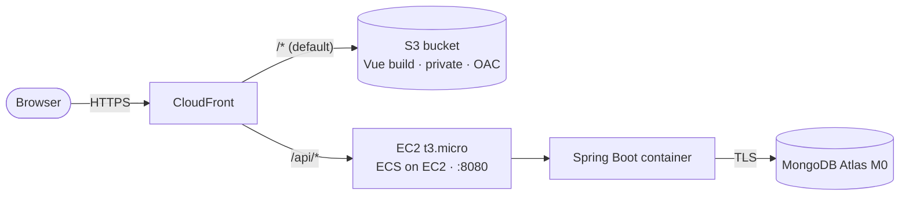

# ClearSpend

Public-finance transparency + anomaly detection. Ingests public spending data from
multiple public sources, normalizes it into MongoDB, flags anomalies with
**explainable** rules, and serves a search dashboard.

**Live demo:** https://d2bkm3h6exrhk5.cloudfront.net

**Stack:** Java 21 · Spring Boot 4 · MongoDB Atlas · AWS (ECS on EC2 · ECR · S3 · CloudFront)
_Planned: SQS async ingestion · anomaly engine._

## Status
✅ **Phase 1 — walking skeleton live on AWS**: one record flows end-to-end
(USAspending → MongoDB → REST API → dashboard), deployed behind CloudFront.
Next: async ingestion (SQS + worker + DLQ), then the anomaly engine.

## Run locally
Requires **Java 21** and **Docker**.

```bash
docker compose up -d         # MongoDB on :27017
./mvnw spring-boot:run        # API on :8080 (JAVA_HOME must point to a Java 21 JDK)
```
All endpoints live under `/api` (`server.servlet.context-path=/api`):
`curl http://localhost:8080/api/actuator/health`

Frontend (Vite/Vue) in `frontend/`:
```bash
cd frontend && npm install && npm run dev   # http://localhost:5173
```

## Deployment (AWS)

The whole app sits behind **one CloudFront distribution** that serves the Vue
frontend *and* proxies API calls to the backend. Because both are the same
origin, there is **no CORS and no mixed-content** problem, and HTTPS is free via
the default `*.cloudfront.net` certificate (no custom domain required).



| Layer | Service | Notes |
|---|---|---|
| CDN / TLS | CloudFront | Free `*.cloudfront.net` cert; 2 origins, 2 behaviors |
| Frontend | S3 (private + OAC) | Vue/Vite static build; only CloudFront can read the bucket |
| Backend | ECS on EC2 (t3.micro) | Docker image from ECR; free-tier instance + Elastic IP |
| Database | MongoDB Atlas (M0) | Connection string injected via `MONGODB_URI` |
| Registry | ECR | `clearspend-backend:latest` (linux/amd64) |

**CloudFront behaviors**
- `default (*)` → S3 origin — `CachingOptimized`
- `/api/*` → EC2 origin (**HTTP only, port 8080**) — `CachingDisabled` + `AllViewer`
  so query strings and `POST` pass through to the backend

The backend sets `server.servlet.context-path=/api`, so `/api/*` maps directly
onto the backend with no path rewriting at the edge.

### Deploy flow
```bash
# 1. Build the backend image for the target arch, push to ECR
docker build --platform linux/amd64 -t <ecr>/clearspend-backend:latest .
docker push <ecr>/clearspend-backend:latest

# 2. Frontend: build with the prod API base, upload to S3
VITE_API_BASE=/api npm run build         # frontend/.env.production
aws s3 sync dist/ s3://<frontend-bucket>/
```
- **ECS on EC2:** a t3.micro (ECS-optimized AMI) joins the cluster through
  user-data (`ECS_CLUSTER=clearspend`); an ECS service runs the task with bridge
  networking and host port 8080. An **Elastic IP** gives CloudFront a stable origin.
- **CloudFront:** S3 origin (OAC) + EC2 origin (HTTP:8080), behaviors as above.

### Cost & on/off
t3.micro + S3 + CloudFront stay within the 12-month free tier → **~$0/month** at
demo traffic. To pause the backend:
```bash
aws ecs update-service --cluster clearspend \
  --service clearspend-backend-ec2 --desired-count 0 --region us-west-2
```
CloudFront + S3 keep serving the site for free. An AWS Budget alerts at $5.

## Design decisions (ADR)

**Core**
- **MongoDB** over relational — absorbs heterogeneous multi-source schemas and
  keeps raw provenance; aggregation pipeline handles analytics.
- **Async ingestion** (SQS + worker + DLQ) over a synchronous fetch-and-write job
  _(Phase 2)_.
- **Idempotent upsert** on `(source, externalId)` — replays and at-least-once
  delivery converge to the same state, never duplicate.
- **Explainable anomaly rules** (statistical, via aggregation pipeline) over ML —
  no fraud labels to train on, and every flag is defensible _(Phase 3)_.
- **Raw payload preserved** so records can be reprocessed when mappings improve.

**Ingestion (Phase 2)**

### ADR-02 — Asynchronous ingestion (SQS + worker + DLQ), not synchronous fetch-and-write
**Decision:** A scheduler enqueues one **page-job** message `{source, page, limit}` per
page to an **SQS** queue; a **worker** long-polls the queue, fetches that page,
normalizes it, and upserts into MongoDB. Messages that fail 5 times are parked in a
**dead-letter queue**.
**Why:**
- **Isolation** — one failing page (or source) doesn't block the batch; only that
  message retries.
- **Backpressure** — the worker consumes at its own pace, so a slow or bursty source
  never stalls the read API.
- **No lost work** — at-least-once delivery + DLQ means a bad message is retried and,
  if still bad, kept for inspection rather than dropped.
- **Decoupling** — scheduler and worker scale and fail independently.

**Exactly-once effect:** SQS delivers at-least-once (messages can be redelivered), so
correctness relies on the **idempotent upsert** on `(source, externalId)` (ADR-03) —
reprocessing a job converges to the same state and never duplicates.

**Rejected:** a synchronous fetch-and-write loop — one source's failure blocks the whole
batch, there is no isolation or backpressure, and a retry re-runs the entire job.

**Verified in practice:** killing the worker mid-batch and restarting it let the
in-flight messages reappear after the visibility timeout; they were reprocessed and the
document count converged — **no loss, no duplicates**. (Gotcha observed: a local worker
and the deployed worker polling the *same* queue compete for messages — use a separate
queue per environment.)

**Deploy (this phase)**

### ADR-07 — Compute: ECS on EC2 (revises ADR-05: Fargate)
**Decision:** Run the container with **ECS on an EC2 t3.micro**, not Fargate.
**Why:** t3.micro is free-tier (750h/month) → ~$0 running 24/7 for the first 12
months, with no "remember to scale to zero" discipline; also exercises EC2 /
ECS-on-EC2 fundamentals. Same Docker image, same ECS control plane.
**Rejected:** Fargate — per-task billing, must scale to 0 to reach $0, no EC2 free
tier. **Trade-off:** we now manage the instance (OS patching) and lose some
elasticity — acceptable for a single-container learning project.

### ADR-08 — One CloudFront distribution fronts both frontend and backend
**Decision:** A single CloudFront distribution: `default (*)` → S3 (frontend),
`/api/*` → EC2 (backend).
**Why:** an HTTPS frontend cannot call an HTTP backend (mixed-content). Putting
both behind one CloudFront makes them the **same origin** → removes mixed-content
**and** CORS, uses the free `*.cloudfront.net` cert (no domain to buy), and needs
no load balancer (CloudFront talks straight to the EC2 origin).
**Rejected:** (a) ALB + ACM HTTPS — needs an owned domain and ~$16/mo always-on;
(b) frontend → raw EC2 IP — mixed-content plus an ephemeral IP; (c) Vercel for the
frontend — another vendor and still stuck on the HTTP-backend problem.

### ADR-09 — Frontend on S3 (private) + CloudFront OAC, not Vercel
**Decision:** Ship the static build to a **private S3 bucket**, served through
CloudFront via **Origin Access Control**.
**Why:** all-AWS (one provider, one bill); the bucket is never public (only
CloudFront can read it via OAC); fits naturally under the shared CloudFront in
ADR-08.
**Rejected:** Vercel (extra vendor, and its HTTPS frontend still can't reach the
HTTP backend); S3 website hosting with a public bucket (less secure, no direct HTTPS).
